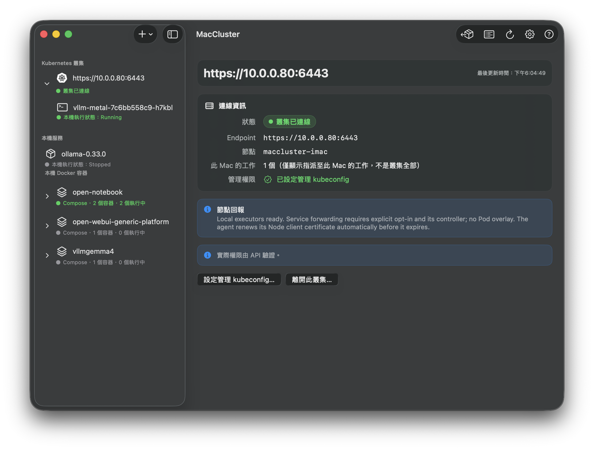

# MacCluster

在 Mac 上管理 Docker 容器與原生服務，並接收 Kubernetes 指派的工作。

MacCluster 提供 macOS 原生介面與 CLI。讓 nginx 在 Docker Desktop 中運行，並在同一個介面查看狀態與日誌。



## 專案特點

- ✅ 透過 Kubernetes Deployment、ReplicaSet 與 Pod 管理 Mac 上的工作，支援多叢集與 namespace。
- ✅ 以 Docker Desktop 執行容器，或選擇 macOS 原生程序。
- ✅ 提供 GUI 與 CLI，共用背景管理程式；可查看狀態、日誌與事件。
- ✅ 支援副本調整、健康探針、優雅停止，以及部分 `kubectl logs`、`exec`、`cp`、`attach` 與 `port-forward` 功能（依 kubelet 端點設定而定）。
- ❌ 不提供完整 Kubernetes 相容性，也沒有一般 Linux 節點的 CNI／Pod 網路；Mac Pod 沒有 Pod IP，預設無法直接連線叢集 DNS 與 Service。
- ❌ 原生程序沒有 Linux cgroup 與 namespace 隔離，不能套用 Linux 節點的 CPU／記憶體硬限制。
- ❌ 原生執行目前不支援 Pod volumes；Native 的 Metal 資源也不能透過 device plugin 交給 Kubernetes 排程。

## 安裝

### 從原始碼建置

先安裝並完成 **Xcode 26 以上（macOS 26 SDK／Swift 6）**的首次設定。腳本會自動選用相容工具鏈；若缺少 Go 1.25 以上，會下載官方版本、核對 SHA256 並安裝到專案 `.tools/`。在專案根目錄執行：

```bash
./scripts/build.sh
open dist/MacCluster.app
```

輸出為 `dist/MacCluster.app` 與 `dist/maccluster-agent`。完整工具鏈設定、CLI 啟動與開發檢查見[使用與建置指南](docs/getting-started.md)。

## 系統需求

- **macOS 14 以上**；Liquid Glass 效果需要 macOS 26。
- 主要實測平台為 **Apple Silicon**，不代表所有 Mac 型號皆已驗證。
- 執行 Docker 工作時，需要可用的 **Docker Desktop**。
- 執行原生工作時，需要先準備好程式、模型或 Python venv 等依賴。
- 加入 Kubernetes 叢集時，Mac 必須能連線到 control plane。

## 功能

- **多叢集管理**：加入、查看與退出叢集，分別保存連線設定與節點憑證。
- **Docker 與原生執行**：預設使用 Docker，也能執行可使用 macOS 原生程序。
- **本機服務管理**：不加入叢集，也能建立 Docker 容器或原生服務。
- **Docker Compose 分組**：依 Compose 標籤顯示專案與容器。
- **容器資訊**：查看日誌、容器設定與資源用量，啟停外部 Docker 容器。
- **執行環境**：登記本機 Python venv 或工具目錄，供原生工作選擇。
- **日誌與事件**：ANSI 日誌顏色、分級事件，以及叢集加入、退出與 Pod 狀態紀錄。
- **純 CLI 操作**：GUI 與 CLI 共用同一個背景 agent，關閉 GUI 後仍可管理工作。

## 快速開始

### 使用 GUI

1. 啟動 Docker Desktop（若需要執行容器），再開啟 MacCluster。
2. 點左上角 **＋**，選擇加入叢集、新增 Docker 容器或啟動原生服務。
3. 在側邊欄選取叢集或服務，查看狀態與日誌；點箭頭或雙擊群組可展開內容。
4. 從右上角進入執行環境、運行日誌、設定與 FAQ。

加入叢集時，貼上 control plane 提供的 `kubeadm join` 指令，並填入 Node 名稱。名稱預設留白，右側「預設」按鈕可填入目前 hostname。

### 使用 CLI

在專案根目錄執行：

```bash
./dist/maccluster-agent --help
./dist/maccluster-agent status
./dist/maccluster-agent env list
./dist/maccluster-agent inventory
```

管理指令需要背景 agent 運行。若沒有使用 GUI 啟動的背景服務，可在另一個終端執行 `./dist/maccluster-agent serve`；已有 agent 時不需重複啟動。

新版背景服務在代理收到 `kill -9 <PID>` 後保持停止；一般退出仍會自動重啟。用 `service start` 恢復，升級套用方式見下方 CLI 指南。

建立環境、加入叢集、建立服務與刪除工作的完整範例，見[CLI 使用方式](docs/getting-started.md#純-cli-使用方式)。

### 使用 AI Skill 部署

專案附有 [deploy-to-mac-node skill](.claude/skills/deploy-to-mac-node/SKILL.md)，放在 Claude Code 的專案 skill 目錄 `.claude/skills/`。它提供 Docker、原生程序與執行環境的 YAML 範本，協助 AI 檢查節點、產生設定、部署及確認 Pod 狀態。

先讓 Mac 加入叢集，並在執行 AI 工具的環境準備好 `kubectl` 與具有部署權限的 kubeconfig；原生程式及執行環境也須先在 Mac 上準備完成。接著在專案目錄開啟 Claude Code，明確指定使用 skill，例如：

```text
請使用 deploy-to-mac-node skill，將 nginx:alpine 部署到
maccluster-node 節點，使用 maccluster-test namespace，副本數為 1。
使用 Docker executor，不修改其他 namespace 的工作。
完成後確認 Pod Ready，並回報服務存取方式與清理指令。
```

請替換範例中的節點、namespace、環境與模型路徑。其他 AI 工具也可明確讀取該 `SKILL.md`，但是否自動載入取決於工具的 skill 支援方式。

Skill 是部署操作指引，不是額外的背景服務，也不會自動取得叢集權限。實際操作仍透過 `kubectl` 與 MacCluster agent 完成；進階功能的啟用條件與最新驗證結果請以專案文件為準。

## 常見問題

### 可以直接用 kubeadm 把 Mac 加入叢集嗎？

MacCluster 接受 `kubeadm join` 指令作為輸入，但不直接執行它。平台會解析參數，處理 CA 驗證、憑證申請、Node 註冊與工作協調。

### 為什麼需要管理 kubeconfig？

Bootstrap token 用於加入，不代表管理員權限。刪除 Deployment、必要時移除 Node 等管理操作需要相應授權。管理 kubeconfig 為選填，路徑必須位於這台 Mac，實際權限由 Kubernetes RBAC 決定。

### 怎麼選擇 Docker 或原生執行？

在 Deployment 的 `spec.template.metadata.labels` 設定：

```yaml
maccluster.example.com/managed: "true"
maccluster.example.com/executor: native
```

省略 executor 或設成 `docker` 時使用 Docker。原生工作使用 `command` 與 `args` 指定程式，不會因為填了 image 就自動安裝應用程式。完整 YAML 見 [examples](examples)。

(在常見問題裡面也有說明)

### 關閉視窗會停止服務嗎？

不會。GUI 與背景 agent 分開運行。明確的停止／drain 操作才會停止管理中的工作；一般 agent 重啟會嘗試接管既有工作。詳見[重啟與接管設計](docs/agent-restart-design.md)。

### 執行環境會自動建立 venv 或安裝套件嗎？

不會。先建立環境並安裝依賴，再透過 App 或 `env add` 登記。移除登記也不會刪除原本的環境目錄。

### 為什麼 Pod 一直 Pending？

先用 `kubectl describe pod` 檢查節點選擇、taint、環境是否存在、埠是否占用，以及不支援的 Pod 規格。原生工作仍共用 Mac 的資源與埠；namespace 不是主機隔離邊界。

### 與一般 Linux Kubernetes 節點完全相同嗎？

不是。目前仍是原型，不宣稱完整 Kubernetes 相容，也沒有完整 Pod overlay／CNI。Service 轉送、kubelet 端點與其他進階功能需要額外設定；Node Ready 不代表所有網路能力就緒。請參考[功能差異與進度](docs/node-gap-roadmap.md)及[實測紀錄](docs/validation.md)。

### 為什麼要有原生的終端運行環境？

像是 vLLM 這類的服務如果要在 macOS 上面做加速推理，就必須使用 Metal 加速，但基於虛擬環境的 Docker 無法正確調用主機的底層加速，因此能透過原生終端的方式能讓 Control Plane 去管理。

## 文件

- [文件索引](docs/README.md)：使用文件、技術設計、驗證與歷史規劃的分類入口。
- [使用與建置指南](docs/getting-started.md)：完整 GUI、CLI、建置與問題排查。
- [管理 API](docs/management-api.md)：指令 JSON 格式與行為。
- [固定埠](docs/fixed-ports.md)：原生服務的埠設定。
- [Service 網路](docs/service-network.md)：網路架構與啟用條件。
- [kubectl 與 kubelet 功能](docs/kubectl-and-kubelet.md)：日誌、exec 等支援範圍。
- [驗證紀錄](docs/validation.md)：已實測項目與限制。
- [去識別化與發布檢查](docs/privacy.md)：示範值、掃描範圍與圖片例外。

## 問題回報

回報時請附上 macOS 版本、Mac 晶片、App／agent 版本或 commit、重現步驟與相關日誌。若是 Kubernetes 問題，也請附上 Pod 狀態與 Events。

請先移除 token、私鑰、完整 kubeconfig 等機密；截圖中的主機名稱與位址也請確認是否適合公開。
